# REPLicant.jl

<p align="center"></p>

Julia's startup and compilation latency makes a fresh process per snippet too
slow for tools that run many small evaluations. REPLicant keeps one Julia process
warm as a socket server and reuses it. `julia +rpc <args>` forwards code to the
server for the current project, prints the result, and pays the cold start once.
State survives between calls.

## Installation

See [Install REPLicant](plugins/replicant/docs/how-to/install.md), or
[set it up through a coding agent](plugins/replicant/docs/how-to/set-up-coding-agents.md)
such as Claude Code or Codex.

## Quick use

Start a server from an interactive `julia` in your project:

```julia
using REPLicant
REPLicant.Server()
```

Then, from a shell in the same project:

```bash
julia +rpc -e '6 * 7'
```

[Start a server from startup.jl](plugins/replicant/docs/how-to/manage-a-server.md#start-a-server-from-startupjl)
so every interactive session serves its project.

## Documentation

See [the docs](plugins/replicant/docs/README.md). REPLicant runs any code sent to it with your
user's permissions; the [security model](plugins/replicant/docs/explanation/security.md) covers
who can send it code.
